# Endless Orgasm Machine
**An automated orgasm denial and enhancement device for the DIY community**

<p align="center">
  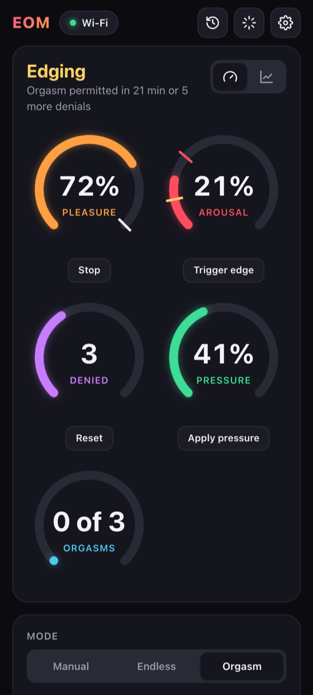
  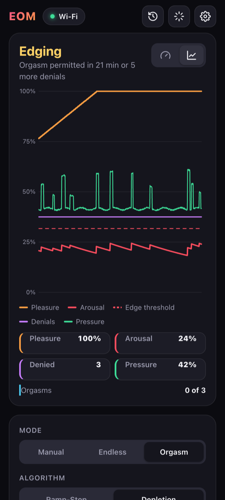
  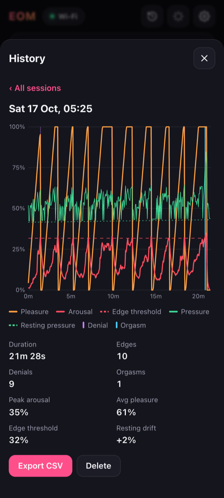
</p>

### It knows...
What will surprise you most is how accurate it is that you only have a few moments left.  In this day and age algorithms are a respected part of our lives...this one knows you better than yourself.

Have you ever cut-off a sneeze before it happened and found it a conflicting blend of sensations?  Have you ever stopped before your orgasm so you could last a bit longer?  If you're not afraid to use a buttplug and you're ready for an amazing experience this is for you.

It is not a sex-toy in the traditional sense because it doesn't provide pleasure unless you connect it to other toys.  It is an arousal sensor.  Other devices provide the pleasure, EOM tells them when to stop and when they can start again. (The exception being if you build in an integrated vibrator or e-stim plug)

### The science!
Using an inflatable butt plug to detect pressure changes indicative of pelvic floor contractions, this software, and associated hardware, is used to detect when the user is approaching orgasm and control stimulation accordingly. The net result: automated edging and orgasm denial or enhancement.

### But I like orgasms...

Having to wait for it while being right at the edge makes it more intense!  Trying to resist getting close is a turn-on for some.  When you're ready to end the edging, **Orgasm mode** allows you to finish after a chosen number of minutes or denials, and then decides what happens next: ruin it, keep going through it, or rest and start edging again for another one.  If you've had enough, switch to **Manual** and take control of the toys yourself.  It can also be used after orgasms to determine exactly when the refractory period has subsided enough to begin the next round of pleasuring.

### Bonus feature:
You could use the app by itself to control multiple sex toys at once without an EOM being involved.  The app by itself is a versatile and simple control hub.

---

## Contents

- [What's new](#whats-new)
- [The app](#the-app)
- [Modes](#modes)
- [Session history and auto-calibration](#session-history-and-auto-calibration)
- [Heart rate](#heart-rate)
- [Safety](#safety)
- [Status LED](#status-led)
- [Hardware](#hardware)
- [Building the software](#building-the-software)
- [Updating the device](#updating-the-device)
- [Testing without a pressure sensor](#testing-without-a-pressure-sensor)
- [Bluetooth and Xtoys](#bluetooth-and-xtoys)
- [WebSocket and Bluetooth API](#websocket-and-bluetooth-api)
- [Building tips](#building-tips)
- [Wait, isn't this the Edge-o-Matic 3000? Or the Nogasm?](#wait-isnt-this-the-edge-o-matic-3000--or-the-nogasm)

## What's new

|Version|What changed|
|---|---|
|**3.8.0**|**Check for updates** in the app installs the newest release for your board.  [Firmware updates](#updating-the-device) over Wi-Fi as well as Bluetooth.|
|**3.6.0**|[Detailed recording](#session-history-and-auto-calibration) of the raw pressure at full speed, with a detailed CSV export.  [Arousal fade time and arousal memory](#arousal-fade-and-memory) settings for the quiet spells between contractions.|
|**3.5.0**|[Heart rate](#heart-rate) from a Wellue/Viatom O2Ring (including the SleepHQ O2 Ring Pro): shown live, recorded in history, and optionally used for cooldowns, edge detection, orgasm detection and a safety stop. A time axis on the live chart.|
|**3.4.0**|[Session history](#session-history-and-auto-calibration) with charts, stats and CSV export. Automatic calibration that follows your resting pressure, and a suggested edge threshold based on your past sessions.|
|**3.3.0**|[After-orgasm modes](#after-an-orgasm): Ruin, Post-orgasm or Milking. An Orgasms counter. A [pressure simulator](#testing-without-a-pressure-sensor) build for testing without a sensor.|
|**3.2.0**|[Safety stops](#safety): sensor fault, lost connection, session time limit and an output limit. Fixed Bluetooth setting changes resetting other settings.|
|**3.1.0**|[Status LED](#status-led) shows when the app is connected. Optional settings lock after an orgasm.|
|**3.0.0**|A [new app](#the-app) with every device setting in it, gauges and chart views, and a phone-friendly layout. The device now starts **stopped** instead of running Endless mode. Settings changed over Bluetooth are saved, and the device can be restarted from the app over Bluetooth.|
|**2.x**|[Firmware updates over Bluetooth](#updating-the-device), signed firmware with automatic rollback, and signed GitHub releases for each board. ESP-IDF 5.5.2. Support for the M5Stack Atom Echo.|

## The app

[The app is hosted at https://backroom-labs.github.io/eom/](https://backroom-labs.github.io/eom/) and can be installed on Android or a PC as a PWA for offline use.  There are also Android and iOS builds in [eomui/](eomui/).

The app is not hosted on the device; the ESP32 only provides Bluetooth and a WebSocket API.

### Connecting

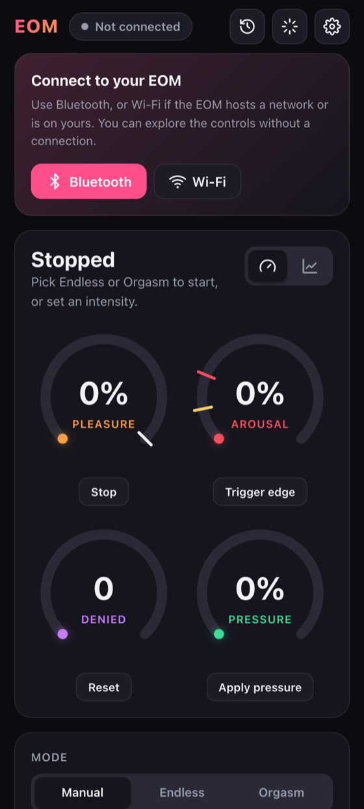

- **Bluetooth** (recommended): tap **Bluetooth** and pick your EOM (it shows up as `EOM_BT`, or whatever `bt_display_name` is set to).  No Wi-Fi setup needed.  Web Bluetooth works in Chrome and Edge on Android and PC.  Apple and Firefox don't support it, so use Wi-Fi there (or build the iOS app from [eomui/](eomui/)).
- **Wi-Fi**: tap **Wi-Fi** and enter your EOM's address.  On the EOM's own network it is `wss://192.168.4.1/`; on your network it is `wss://eom.local/` (or the IP shown in the serial monitor).  Because the hosted app is served over https, browsers require a secure (`wss://`) connection: visit `https://192.168.4.1/` once and accept the self-signed certificate before connecting.

You can explore the controls before connecting.  The status LED on the device turns green once the app is connected (see [Status LED](#status-led)).

<br clear="right">

### The main screen

<p align="center">
  
  
  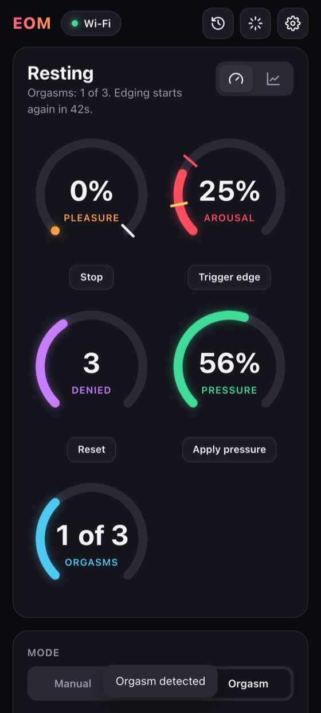
</p>

- **Status** at the top says what the EOM is doing right now: Stopped, Building pleasure, Edging (with the time or denials left before an orgasm is permitted), Denied (with the cooldown), Orgasm detected, Resting, or Ruined.
- **Gauges or chart**: switch with the buttons at the top right.  The gauges show **Pleasure** (output to your toys), **Arousal** (with the edge threshold marked), **Denied** and **Pressure**.  In Orgasm mode an **Orgasms** gauge is added.  The chart shows the same values over time, plus the edge threshold.
- The buttons under each gauge are shortcuts: **Stop**, **Trigger edge** (start a cooldown now), **Reset** the denial count, and **Apply pressure** (shorter ramp and cooldown, higher threshold).
- **Mode** and **Algorithm** pick how the session runs (see [Modes](#modes)).  In Manual mode an **Intensity** slider controls the toys directly.  **Stop now** always switches to Manual at 0%.
- **Quick settings** under the controls show the settings you're most likely to change mid-session.  In Orgasm mode these include the edging time, the denials before orgasm, and what happens after an orgasm.

On a wider screen the controls move next to the chart:

<p align="center">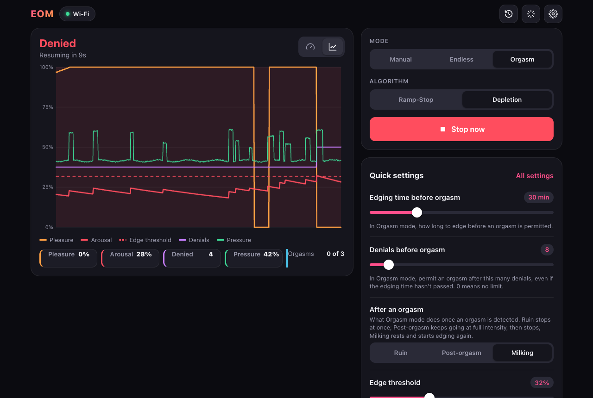</p>

The top bar has three more buttons: **History** (with a red dot while a session is being recorded), **Toys**, and **Settings**.  While a toy is connected, the top bar also shows each toy's level and what it follows, with a button to stop it (see [Toys](#toys)).

### Toys

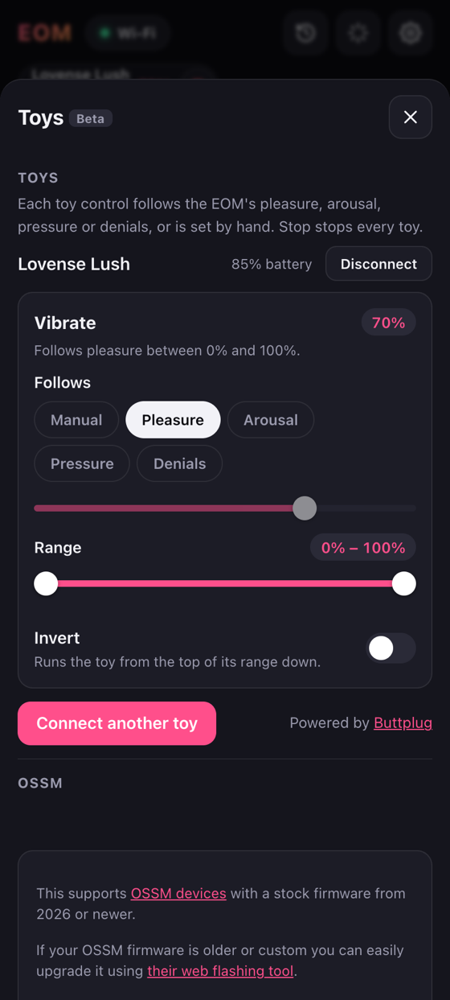

The **Toys** panel connects other toys to the app so they follow the EOM:
- Bluetooth toys through [Buttplug.io](https://buttplug.io/) (vibrators, strokers and many more)
- An [OSSM](https://github.com/KinkyMakers/OSSM-hardware) stroker
- A Bluetooth LED strip that shows the EOM's status colour

Each toy control can follow **Pleasure**, **Arousal**, **Pressure** or **Denials**, or be set by hand in **Manual**.  **Range** limits how weak and how strong it goes, and **Invert** runs it from the top of its range down.  A toy starts on Manual when it connects, and gets back the range and invert you last set for it on this phone or browser.

While a toy is connected, the top of the main screen shows it with its level and what it follows.  Its stop button stops it and switches it to Manual; **Stop all toys** appears when more than one is connected.

<br clear="right">

### Settings

<p align="center">
  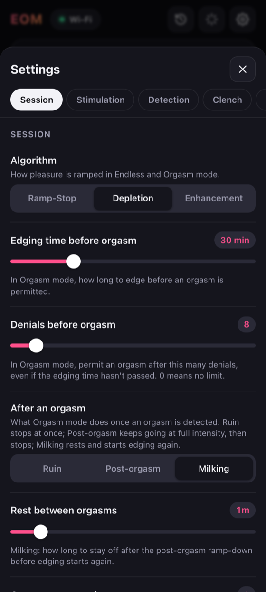
  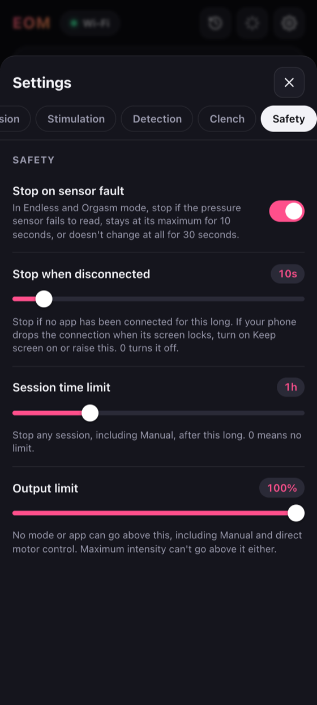
  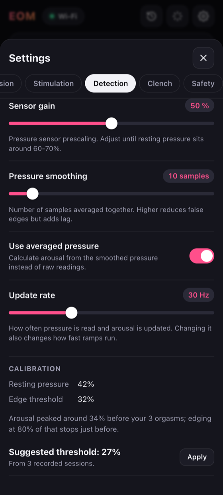
</p>

Every device setting is in the app, grouped into tabs.  Changes are sent to the device straight away and saved there, over Bluetooth or Wi-Fi.  Settings marked as needing a restart can be applied with **Restart device**.

|Tab|What's in it|
|---|---|
|**Session**|Algorithm, edging time and denials before orgasm, what happens after an orgasm, rest between orgasms, orgasms per session, settings lock during Orgasm mode|
|**Stimulation**|Maximum and starting intensity, ramp time, edge cooldown, random extra cooldown, minimum on time|
|**Detection**|Edge and warning thresholds, sensor gain, pressure smoothing, update rate, **Calibration** (resting pressure, suggested threshold)|
|**Clench**|Clench detection and orgasm detection, post-orgasm duration, settings lock after an orgasm, **Follow resting pressure**|
|**Safety**|Stop on sensor fault, stop when disconnected, session time limit, output limit|
|**Connectivity**|Wi-Fi (own network or join yours), network name and password, hostname, secure WebSocket, Bluetooth name, Bluetooth and Wi-Fi together|
|**App**|Settings for this app only: start view, keep screen on, record sessions, pressure simulator, Apply pressure step|
|**Device**|Firmware version, [firmware update over Bluetooth](#updating-the-device), restart|

If **Lock settings during Orgasm mode** or **Lock settings after orgasm** is on, settings can't be changed until the Orgasm session ends.  This is useful if someone else sets the rules.

## Modes

### Control modes

|Mode|What it does|
|---|---|
|**Manual**|You set the intensity.  The device starts in Manual at 0% (stopped) every time it boots.|
|**Endless**|Edging forever.  Pleasure builds until an edge is detected, then stops for a cooldown and starts again.|
|**Orgasm**|Edging until an orgasm is permitted, either after **Edging time before orgasm** or after **Denials before orgasm**, whichever comes first.  Then it lets you finish and does what **After an orgasm** says.|

### Algorithms

|ID|Name|Description|
|---|---|---|
|1|Ramp-Stop|Pleasure ramps up, stopping abruptly on arousal threshold crossing.  It's very frustrating.|
|2|Depletion (default)|Pleasure ramps up, but is reduced for even small arousal spikes.  This makes for a constant interaction with your arousal rather than just a sudden cutoff when it's over the limit.|
|3|Enhancement|This is the opposite of edging, it will make you orgasm faster.  Pleasure ramps up as arousal increases, holding a peak for ramp_time.  Not compatible with Orgasm mode.|

### After an orgasm

In Orgasm mode, once an orgasm is permitted the EOM watches for one: a clench held for **Clench time to orgasm**.  What happens next is set by **After an orgasm**:

|Setting|What happens|
|---|---|
|**Ruin**|Stimulation stops the moment the orgasm is detected.|
|**Post-orgasm** (default)|Full intensity for **Post-orgasm duration**, then it ramps down and stops.|
|**Milking**|Like Post-orgasm, then it rests for **Rest between orgasms** and starts edging again for the next one.  The app shows a countdown while resting.  After **Orgasms per session** (0 = no limit) the last one ends like Post-orgasm.|

The **Orgasms** counter shows how many were detected this session (for example "1 of 3" in Milking).  It resets when a mode is started.

## Session history and auto-calibration

<p align="center">
  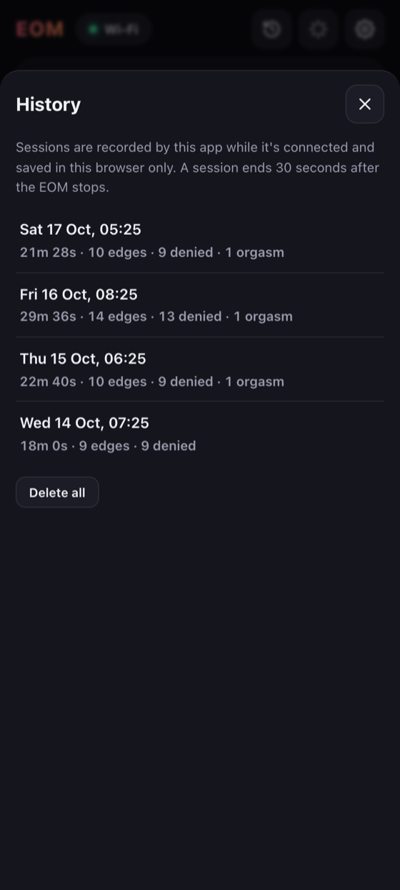
  
</p>

The app records every session while it's connected and keeps it **in that browser only**; nothing is stored on the device.  Open **History** in the top bar to see your past sessions.  Each one has:
- a chart of pleasure, arousal, edge threshold, pressure and resting pressure, with denials and orgasms marked
- duration, edges, denials, orgasms, peak arousal, average pleasure, edge threshold and resting-pressure drift
- **Export CSV** to keep or analyse the readings elsewhere
- **Export detailed CSV**, if **Settings > App > Detailed recording** was on: the raw pressure at the EOM's full update rate (50 times a second) with the other readings alongside, for studying contraction patterns.  Needs firmware 3.6.0, and it takes more storage in the browser.

A session starts when a mode runs or the intensity goes above 0, and ends 30 seconds after the EOM stops.  Sessions shorter than 15 seconds aren't kept, and the last 200 are saved.  Turn recording off under **Settings > App > Record sessions**.

**Follow resting pressure** (Settings > Clench, on by default) keeps detection accurate when the plug's resting pressure drifts during a session, for example as it warms up or air leaks out.  The device tracks your resting pressure and keeps the clench threshold above it.  Arousal is measured from pressure changes, so drift doesn't affect edge detection.

**Suggested threshold** (Settings > Detection > Calibration) looks at your last 10 recorded sessions and suggests an edge threshold:
- If you had orgasms, 80% of how high your arousal peaked just before them, so edging stops just before that point.
- Otherwise it adjusts from your latest session: raise it if you edged constantly (more than 2 edges a minute), lower it if you went 10 minutes without an edge.

Tap **Apply** to use the suggestion.

### Arousal fade and memory

Arousal is built up from the size of your contractions and fades when they stop.  Involuntary contractions tend to come in waves, often around a minute on and a minute off, and you can still be close to orgasm during the quiet part.  Two settings in **Settings > Detection** help with that:

|Setting|Default|What it does|
|---|---|---|
|**Arousal fade time**|1.4 s|How long arousal takes to fall by half once contractions stop.  1.4 s is the classic behaviour; longer keeps arousal up through short pauses.|
|**Arousal memory**|Off|Arousal stays up near its recent peak and fades with this half-life, but never above the **Warning threshold**, so it can't cause an edge by itself.  Small contractions then edge you sooner after you've been close.|

## Heart rate

The app can connect to a **Wellue/Viatom O2Ring** pulse oximeter ring, including rebadged ones such as the **SleepHQ O2 Ring Pro**, alongside the EOM.  Close the ring's own app first (the ring takes one connection at a time), then use **Connection > Heart rate > Connect O2Ring** and pick the ring from the list.  Both the older O2Ring protocol and the newer one (O2Ring S, O2 Ring Pro) are supported.

While it's connected, the app shows a **Heart rate** gauge and chart line, records heart rate with each session (graph line, stats and a `heart_rate` CSV column), and forwards it to the EOM once a second.  The EOM can use it in these ways, all in **Settings > Heart rate** and all off by default:

|Setting|What it does|
|---|---|
|**Wait for heart rate to settle**|After an edge, the cooldown continues until your heart rate has dropped this many bpm from its peak, after **Edge delay** and for at most **Longest wait for heart rate**.  The app shows "Waiting for your heart rate to settle".|
|**Edge zone heart rate**|At or above this heart rate the edge threshold is lowered by **Edge zone threshold drop**, so edges are caught earlier when you're close.  The arousal gauge shows the lowered threshold.|
|**Orgasm heart rate**|In Orgasm mode, a clench only counts as an orgasm if your heart rate is at least this high.|
|**Detect orgasm from heart rate drop**|Experimental.  Once an orgasm is permitted, also count one when your heart rate falls this far within 30 seconds of its peak, without a clench.|

Once a few sessions have been recorded with the ring on, the Heart rate settings tab suggests values for these from your history (heart rate at your edges and orgasms, and how far it falls afterwards).  If the heart rate stops coming in for 5 seconds (ring off, app closed), everything goes back to pressure only.

## Safety

The device stops everything (Manual mode, 0%) if something goes wrong.  The app shows a banner saying why, and starting a mode again clears it.  All of these are in **Settings > Safety**:

|Setting|Default|What it does|
|---|---|---|
|**Stop on sensor fault**|On|In Endless and Orgasm mode, stop if the pressure sensor fails to read, stays at its maximum for 10 seconds, or doesn't change at all for 30 seconds.  The LED flashes red.|
|**Stop when disconnected**|10 s|Stop if no app (Bluetooth or Wi-Fi) has been connected for this long.  A Bluetooth toy reading the EOM counts as connected.  0 turns it off.  If your phone drops the connection when its screen locks, turn on **Keep screen on** in Settings > App or raise this.|
|**Session time limit**|Off|Stop any session, Manual included, after this many minutes.|
|**Output limit**|100%|No mode or app can go above this, including Manual and direct motor control from other apps.|
|**Heart rate limit**|Off|Stop if your heart rate stays above this for 10 seconds.  Needs an O2Ring connected to the app (see [Heart rate](#heart-rate)).|

## Status LED

On boards with an RGB LED (WS2812/SK6812), while no automatic mode is running:

|LED|Meaning|
|---|---|
|Flashing blue|Waiting for the app to connect|
|Solid green|App connected|
|Flashing red|Stopped by a sensor fault|

In Endless and Orgasm mode the LED shows the EOM's arousal colour instead.  This colour is also sent to the app and to a connected Bluetooth LED strip.

## Hardware
#### [Build examples here](doc/building/building.md)
STLs for the wrapped tubing version are in the [/hardware](hardware) directory.

Also included are the source files for customizing your own plug.  They are designed in [OpenSCAD](https://openscad.org/), which may not be the easiest cad program to work with but its completely open-source and easily sharable for customization.

If you go with an inflatable plug you're on your own...There are not yet any files for enclosing the electronics and securing them...there are a million different products you could buy anyways so nothing could be made to fit.  If there is demand I'll post a simple box.

Tested boards: ESP32DEV, ESP32-WROOM32, ESP32-C6 (WaveShare), ESP32-S3 (Seeed and Waveshare), M5Stack Atom Echo.

The **M5Stack Atom Echo** is a small, cased ESP32 board that's easy to get.  Plug the pressure sensor's output into the Grove port's G32 pin.  Its RGB LED is used as the [status LED](#status-led).

### So how do I get one
Well, I'll get a store together eventually but for now you'll have to build it yourself.  These instructions are meant to make the simplest build possible so you can get playing.

## Building the software
- Install [VSCode](https://code.visualstudio.com/) with the [pioarduino extension](https://github.com/pioarduino/platform-espressif32) (or add https://github.com/pioarduino/platform-espressif32 to the [PlatformIO](https://platformio.org/) extension)
- Open this repo and let all the PlatformIO dependencies download
- Pick your board in [platformio.ini](platformio.ini):

  |Board|Environment|
  |---|---|
  |Generic ESP32, e.g. WROOM|`esp32dev`|
  |M5Stack Atom Echo|`m5stack_atom_echo`|
  |Seeed Xiao ESP32-S3|`esp32-s3-devkitm-1`|
  |Waveshare ESP32-S3 Zero|`waveshare_esp32_s3_zero`|
  |Waveshare ESP32-S3 AMOLED 1.32|`waveshare_esp32_s3_amoled_1_32`|
  |Adafruit QT Py ESP32-S3 (no PSRAM)|`adafruit_qtpy_esp32s3_nopsram`|
  |ESP32-C6 DevKit|`esp32-c6-devkitm-1`|

  Only `esp32dev` and `m5stack_atom_echo` are enabled at the moment.  To build another board, uncomment its `[env:...]` section.
- If you want to use Wi-Fi alongside or instead of Bluetooth, set `wifi_on` to true and configure your Wi-Fi SSID and password at the top of [data/config.json](data/config.json), or skip this step to let it broadcast its own access point: `EOM`.  You can have it both ways: set it up to connect to your home Wi-Fi, and if you're away EOM will go into access point mode after it fails to find it.  These can also be changed later in the app under **Settings > Connectivity**.
- Under `PlatformIO -> Project Tasks -> <your board> -> Platform` choose `Build Filesystem Image` then `Upload Filesystem Image`.  This uploads `config.json` plus a self-signed TLS certificate for `wss://`, which is generated into `data/` on your first build (requires `openssl`; see [tools/gen_cert.py](tools/gen_cert.py)).  The certificate and key are unique to your machine and are not committed to git.
- Under `PlatformIO -> Project Tasks -> <your board> -> General` choose `Build` then eventually `Upload and Monitor`
- Watch for your device's IP address to be displayed in the monitor window (in access point mode it is 192.168.4.1)

## Updating the device

Firmware can be updated over Bluetooth from the app, or over USB from PlatformIO.  The flash holds three separate things, and each is updated differently:

|What|Where it lives|Updated by|
|---|---|---|
|Firmware (all code in `src/`, plus a built-in copy of `data/config.json`)|app partition|The app over Bluetooth or Wi-Fi, or `Upload` (`pio run -e <board> -t upload`)|
|Filesystem: `config.json`, `server.crt`, `server.key`|SPIFFS partition|`Upload Filesystem Image` (`pio run -e <board> -t uploadfs`)|
|Settings saved from the app|NVS + SPIFFS|The app, or overwritten as described below|

**Firmware updates from the app.**  Once a device runs firmware with update support (flash it over USB once; Wi-Fi updates need 3.8.0 or later), you can update the firmware from the app over Bluetooth or Wi-Fi: connect, open **Settings > Device**, and under *Firmware update* press **Check for updates** to install the newest release for your board (an EOM on a beta is offered betas too), or choose a `firmware.bin`, either `.pio/build/<your board>/firmware.bin` from your own build or a `firmware-<board>.bin` from a [GitHub release](https://github.com/backroom-labs/eom/releases).  Only one update runs at a time, whichever connection started it.  The filesystem (`config.json`, certificates) and your settings are not touched by these updates.

**Firmware signing.**  Every build signs `firmware.bin` with an ECDSA key that is generated into `keys/` on your first build (requires `openssl`; see [tools/gen_signing_keys.py](tools/gen_signing_keys.py)).  The device will only accept over-the-air updates signed with the same key as the firmware it is running, so **back up `keys/`**: it is not committed to git, and if you lose it, devices have to be updated over USB once more.  This also means a device running your own build only accepts your own builds, and a device running a release only accepts releases.  The device also checks that the image is for the same board and is not older than what it's running.  New firmware that crashes or stops running within 30 seconds of its first boot is rolled back automatically.

**Releases.**  GitHub Actions ([.github/workflows/release.yml](.github/workflows/release.yml)) builds every enabled board in `platformio.ini` on each push and pull request.  Pushing a tag that matches `PROJECT_VER` in `CMakeLists.txt` (e.g. `git tag v3.4.0 && git push origin v3.4.0`) also publishes `firmware-<board>.bin` for each board, a `manifest.json` listing each image's board, version, download URL, SHA-256 and size (see [tools/make_manifest.py](tools/make_manifest.py)), and the built app.  They go to the public Pages site (see [tools/publish_pages.sh](tools/publish_pages.sh)): the newest stable release's manifest is always at `https://backroom-labs.github.io/eom/firmware/manifest.json`, the newest release of either kind (betas included) at `https://backroom-labs.github.io/eom/firmware/manifest-beta.json`, and every release's images stay at `https://backroom-labs.github.io/eom/firmware/<version>/`.  The site is this repo's `gh-pages` branch, which the release pushes to with the workflow's own token; the branch must exist before the first release.  A GitHub release carries the same files as an archive.  Releases are signed with the `OTA_SIGNING_KEY` repository secret, which must hold the contents of your `keys/ota_signing_key.pem` so devices accept them; the release fails if the secret is missing.  The same workflow builds the Android app, and the release also carries `eom-<version>.apk`, signed with the `ANDROID_KEYSTORE` (the `.jks` file, base64), `ANDROID_KEYSTORE_PASSWORD` and `ANDROID_KEY_ALIAS` secrets so each release installs over the last one.  Other builds upload a debug-signed APK as a workflow artifact.

### Small code changes: firmware upload only
For day-to-day changes to anything in `src/` or a `build_flags` pin change in [platformio.ini](platformio.ini), you only need to reflash the firmware:

- `PlatformIO -> Project Tasks -> <your board> -> General -> Upload and Monitor`
- or from a terminal: `pio run -e <your board> -t upload -t monitor`
- or build it and send `firmware.bin` from the app over Bluetooth

PlatformIO rebuilds only what changed, so this is quick.  The filesystem (TLS certificate) and the settings saved on the device are left alone.

**Changing settings in `data/config.json`** also only needs a firmware upload.  The file is compiled into the firmware and on boot the device checks whether it has changed since it was last applied.  If it has, every key in the file overrides the value saved on the device; if it hasn't, settings you changed from the app are kept.  An invalid JSON file is ignored (check the monitor for `Built-in config.json is not valid JSON`).

The app is hosted separately (see [eomui/](eomui/)), so app changes never need a device update.  The built app (`eomui/public/index.html`) isn't committed: run `npm run build` in `eomui/` before testing locally, syncing Capacitor or taking screenshots. CI builds it for releases.

### Full image: filesystem + firmware
Do a full update (`Build Filesystem Image` -> `Upload Filesystem Image`, then `Upload and Monitor`) when:

- **Flashing a new board for the first time.**  Without the filesystem image there is no TLS certificate, so the device falls back to plain `ws://` and the hosted https app can't connect over Wi-Fi.
- **The certificate was regenerated**, e.g. you deleted `data/server.crt`/`server.key` or are building from a different computer.  You will need to accept the new certificate at `https://<device-ip>/` again.
- **A partition table changed** (`8mb_spiffs.csv`, `min_spiffs.csv`, or `board_build.partitions` in [platformio.ini](platformio.ini)).  Run `Platform -> Erase Flash` first, because the old layout will not line up with the new one.
- **The device is misbehaving after an update** and you want a clean slate: `Erase Flash`, then filesystem, then firmware.

From a terminal:
```
pio run -e <your board> -t erase      # only for a clean slate or partition changes
pio run -e <your board> -t uploadfs
pio run -e <your board> -t upload -t monitor
```

Be aware that `Upload Filesystem Image` replaces the `config.json` on the device, and `Erase Flash` wipes everything, so **any settings changed from the app are lost**.  Put settings you want to keep into `data/config.json` first.

### Build-system changes: clean build
If you edit `sdkconfig.defaults`, change the ESP-IDF/platform version, or switch boards and get odd build errors, delete the generated `sdkconfig.<your board>` file and run `General -> Clean` (`pio run -e <your board> -t clean`) before building.  `sdkconfig.defaults` is only read when that file doesn't exist yet, so it won't otherwise pick up your changes.  A clean build doesn't touch the device; upload the firmware as usual afterwards.

The firmware is pinned to ESP-IDF 5.5.2 (`espressif32@6.13.0`).  Don't move to 5.5.3 or later 5.5.x without testing: 5.5.3 breaks Bluetooth firmware updates on the classic ESP32.

## Testing without a pressure sensor

You can test on almost any ESP32 without extra hardware by touching the pin assigned to the pressure sensor (see [Building tips](#building-tips)).  For repeatable testing there is also a **pressure simulator** build, which lets the app set the pressure reading:

```
PLATFORMIO_BUILD_FLAGS=-DEOM_PRESSURE_SIM pio run -e <your board> -t upload
```

Then turn on **Settings > App > Pressure simulator**.  The Controls card gets a pressure slider and a **Hold to clench** button.  A normal upload (without the flag) puts the real sensor back.  The simulator is never part of a normal or release build.

## Bluetooth and Xtoys
Wi-Fi is not necessary!  The app works over Bluetooth: no IP address or Wi-Fi setup needed.  Just connect to your EOM directly with the **Bluetooth** button.  Android or PC Chrome/Edge only in the browser; Apple and Firefox don't support Web Bluetooth.

It is set up as a PWA, so you can open https://backroom-labs.github.io/eom/ once and install it as an app.  It does not need an internet connection after installation.

### Bluetooth usage with Xtoys:
Using Xtoys you can connect to the EOM and let it control your other Xtoys devices.  For Xtoys it emulates a device called [MonsterPub Mr. Devil Kegel](https://monsterpub.com/products/mp2-u-shaped-remote-egg-with-kegel).  Connect to the device called "EOM_BT" (or whatever you set `bt_display_name` to).  If Xtoys doesn't list it, set `bt_display_name` to `"Libotoy"`, the name the real MonsterPub device uses.  The "pressure" reading corresponds to the "pleasure" output of the EOM.  The sliders for vibrator strength will work in manual mode.

<small>Why Mr Devil?  Because it's one of the few bluetooth devices in Xtoys that has 2 way communication and high resolution (16 bit).  If you wish to connect Xtoys to the EOM over wifi you can choose the Edge-o-matic 3000 and it is backwards compatible.  This is less useful because Xtoys only chose to implement "arousal" and "pressure" inputs, so all the logic that goes into calculating the amount of pleasure is ignored.</small>

## WebSocket and Bluetooth API

WebSockets are supported for backwards compatibility with nogasm and edge-o-matic devices, but not necessary for Bluetooth.  Documentation for the WebSocket API is in [doc/WebSocket.md](doc/WebSocket.md) and the config keys are in [doc/Config.json.md](doc/Config.json.md).

Newer firmware adds these to the readings, over both WebSocket (`readings`) and Bluetooth (status characteristic, now 62 bytes, multi-byte values MSB first):

|Field|WebSocket|Bluetooth byte|Since|Meaning|
|---|---|---|---|---|
|Settings lock|`lock`|17|3.0.0|Settings are locked|
|Safety stop|`safety`|18|3.2.0|Why the device stopped (0 = not stopped)|
|Orgasms|`orgasms`|19|3.3.0|Orgasms detected this session|
|Phase|`phase`|20|3.3.0|1 post-orgasm, 2 resting, 3 ruined|
|Rest|`rest`|21-22|3.3.0|Seconds left resting (Milking)|
|Resting pressure|`baseline`|23-24|3.4.0|Tracked resting pressure|
|Heart rate|`hr`|25|3.5.0|Heart rate the EOM is using, in bpm (0 = none)|
|Heart-rate state|`hrWait`, `hrZone`|26 (bit 0, bit 1)|3.5.0|Cooldown waiting for the heart rate to settle; heart rate in the edge zone|
|Raw pressure|`rawSeq`, `raw` (last 8)|27-28 reading number (low 16 bits), 29 count, then 16 × 2 bytes|3.6.0|The last raw pressure readings, oldest first; the newest is reading number `rawSeq - 1` since boot|

Bluetooth control commands: `0x02` change a setting (saved), `0x04` save and restart, `0x05` set the simulated pressure (simulator builds only), `0x06 <bpm>` heart rate from an external sensor.  Over WebSocket the heart rate is `{"heartRate": <bpm>}`.

Firmware updates use the same commands, events and result codes over both connections, and the app downloads and checks the image itself (the EOM never fetches firmware).  Bluetooth: [src/include/system/ble_ota.h](src/include/system/ble_ota.h).  WebSocket (3.8.0): `{"otaInfo": null}` reports the version, board, largest image and whether the running firmware is confirmed; `{"otaBegin": {"size": <bytes>, "allowDowngrade": false}}` starts an update; the image follows in binary frames of a 4-byte little-endian offset plus up to 4096 bytes; `{"otaAbort": null}` cancels; and the EOM answers with `{"ota": {"event": "ready" | "progress" | "resend" | "result", "error": <code>, "value": <n>}}`.  See [src/include/system/ws_ota.h](src/include/system/ws_ota.h).

New settings since 3.0.0:

|Key|Default|App label|
|---|---|---|
|`after_orgasm`|1|After an orgasm (0 Ruin, 1 Post-orgasm, 2 Milking)|
|`milking_rest_seconds`|60|Rest between orgasms|
|`milking_max_orgasms`|3|Orgasms per session (0 = no limit)|
|`post_orgasm_menu_lock`|false|Lock settings after orgasm|
|`auto_baseline`|true|Follow resting pressure|
|`arousal_fade_ms`|1400|Arousal fade time|
|`arousal_memory_s`|0|Arousal memory (0 = off)|
|`sensor_fault_stop`|true|Stop on sensor fault|
|`disconnect_stop_s`|10|Stop when disconnected (0 = off)|
|`max_session_minutes`|0|Session time limit (0 = off)|
|`max_motor_output`|255|Output limit|
|`hr_max_bpm`|0|Heart rate limit (0 = off)|
|`hr_recovery_bpm`|0|Wait for heart rate to settle (0 = off)|
|`hr_recovery_max_s`|90|Longest wait for heart rate|
|`hr_edge_bpm`|0|Edge zone heart rate (0 = off)|
|`hr_edge_sensitivity`|20|Edge zone threshold drop (%)|
|`hr_orgasm_min_bpm`|0|Orgasm heart rate (0 = off)|
|`hr_orgasm_drop_bpm`|0|Detect orgasm from heart rate drop (0 = off)|

## Building tips

You can test this out on almost any ESP32 device without any extra hardware by touching the pin assigned to the pressure sensor.  Run your finger over all the pins if you're not sure which one it is.  This will be like a pressure sensor being squeezed.  To actually play with this device you will need to attach an actual pressure sensor and butt-plug (or 3d-printed tubing version).  The [MPX5100DP](https://www.digikey.com/en/products/detail/nxp-usa-inc/MPX5100DP/464060) is the sensor it was designed around but anything capable of 15psi or greater should work whether analog or SPI.  Plug the port of the pressure sensor into the air hose for the butt plug.

To get it to resemble [the original Nogasm device](https://github.com/nogasm/nogasm) you can then add a [12v power supply](https://www.amazon.com/ACEIRMC-Battery-Plastic-Storage-Connect/dp/B0986RMKBJ) and [charger](https://www.amazon.com/Battery-Charger-Lithium-Display-RC123A/dp/B0CRKSFTK9), a [simple transistor](https://www.amazon.com/ALLECIN-IRF4905-Transistors-IRF4905PBF-Transistor/dp/B0CBKGJT9N) or more protected [motor controller](https://www.amazon.com/High-Power-Adjustment-Electronic-Controller-Brightness/dp/B0DZP1NCVW), a [flyback diode](https://www.amazon.com/15SQ045-Diodes-Schottky-Blocking-Silicon/dp/B0D4F2WVS5), and [vibrator motor](https://www.amazon.com/RPTCOTU-R555-Vibration-Motor-Electrodynamic/dp/B0CSYWK5KQ).  You could share that power supply to the esp32 [through a buck converter](https://www.amazon.com/Regulator-Reducer-Converter-Aircraft-MP1584EN/dp/B0B779ZYN1) to make the whole thing wireless.  That's it.  You can set this all up to attach to the buttplug rather than having a wires and tubes leading to a control box, but its a matter of opinion which way is better.

### Customization suggestions
- You can use [Xtoys.app](https://xtoys.app) as a control panel to ramp up any number of vibrators, strokers, or e-stim units in sync with the EOM over bluetooth.  See [this Xtoys layout for an example](https://xtoys.app/layouts/-OcwSDDWBei-Bg4xwe5o)
- If you want to connect Xtoys via wifi you will need SSL enabled (`use_ssl` in `data/config.json`, on by default) and use the edge-o-matic Xtoys device.  The bluetooth connection is more useful since it sends pleasure level rather than arousal but there are some existing xtoys scripts that work with the edge-o-matic arousal level.
- You can use an inexpensive [Vibrating inflatable buttplug](https://www.amazon.com/Lovehoney-Black-Inflatable-Vibrating-Back/dp/B092VVXM63) and remove its control box to wire it directly to the EOM with a power circuit.  A [non-vibrating plug](https://www.amazon.com/Inflatable-Expandable-Stimulator-Beginners-Detachable/dp/B0DSPKVPM1) is even less expensive if you'll be controlling your pleasure wirelessly.
- If an [MPXV5100GP](https://octopart.com/search?q=MPXV5100GP&currency=USD) pressure sensor is too inconvenient or expensive to source you could use an easy to find [generic car exhaust pressure sensor](https://www.amazon.com/dp/B0997VKYQ9) since they are almost all analog 15psi 5v sensors.  The pin with the notch is Vin, middle is ground, third is Vout. Everything tested was 3V compatible.
- If you use an ESP32 board with an integrated screen ([Example 1](https://www.amazon.com/ideaspark-Development-Integrated-Wireless-Micropython), [Example 2](https://www.amazon.com/Waveshare-Development-Frequency-Single-Core-Processor/dp/B0DHTMYTCY)) you can enable the screen in [src/include/config.h](src/include/config.h) to see the IP of the device.
- As an alternative to a vibrating buttplug you can use [a plug made for enema play](https://www.amazon.com/Inflatable-Congestion-Cleaning-Expansion-Beginner/dp/B0CZRLPLQC) and pass a wire through the middle to an e-stim electrode or [to a vibrator on top](https://www.amazon.com/dp/B0024XI1LG).
- Someone posted a build that used tubing wrapped around a 3d printed shaft that also housed the electronics.  It was a neat new twist to the inflatable plug since the tubing reacted to pressure just like an inflatable.  The link is lost to time but it was on github somewhere.
- You could put in a higher range pressure sensor if you prefer to inflate the plug to more intense levels.  The measurement is of change in pressure, not overall pressure.
- You could order a [prebuilt PCB like is used for the Nogasm-esp32](https://github.com/Mathew3000/nogasm-esp32)
- There really are a ridiculous number of implementations of the nogasm concept from the last decade...you should do some nogasm googling.


## Wait, isn't this the Edge-o-Matic 3000?  Or the Nogasm?

This is a fork of that project with a different set of goals.  The main goal is to make the project accessible to the maker community by keeping the hardware and software simple and DIY friendly - like [the original Nogasm](https://github.com/nogasm/nogasm) that started it all was.  The Edge-o-Matic code is designed around selling well-made but proprietary hardware and is [locked into it through closed-source code](https://github.com/MausTec/eom-hal-dist), crippling attempts to use it with DIY hardware.  It also included a lot of code to connect to related products and services.

This project was first vastly simplified then expanded with compatibility in mind.  You can try it using almost any modern ESP32 device with no additional customization.  You will need to connect a pressure sensor and inflatable buttplug to make it functional, but that's it.  It's meant to be operated wirelessly rather than through the additional hardware of a screen, knob, LEDs, network jack, etc.

Some notable differences are:
- Runs on nearly any ESP32 board!  DIY friendly
- Connects through bluetooth low energy, and firmware updates over Bluetooth or Wi-Fi
- Orgasm mode available in the app (denies orgasms until timer runs out), with Ruin, Post-orgasm and Milking endings
- Maximum denial count, so you get to finish after X number of edges
- App hosted as a PWA (or Android/iOS app) and phone friendly, with session history
- Safety stops for sensor faults and lost connections
- Starts stopped; you pick the mode
- smaller build size, fits in your butt
- SD card requirement removed
- menu system removed
- console system removed
- action manager system removed
- hardwire networked device support removed
- edge times are in seconds


## Standing on the shoulders of giants
This is a product of the open source community.  This will always be open source.  Sharing knowledge this way goes back to patent offices, or perhaps cave-man fire.  Sometimes the term can be abused by making things appear open when key information is obfuscated or by taking formerly open repositories offline...that practice of monetizing is also as old as time.  No shame.  Open-source doesn't mean no profiting and I'll try to make some money too. However this particular project intends to focus on information sharing and DIY accessibility as much as functionality.  You should be always be able to build this yourself if you have the free time.  That may not be the most profitable route but I hope the open-source community can elevate this project and make it even more useful than I am capable of.

## Contribution and Inspiration from:

- **Rhobot** with the original [nogasm project](https://github.com/nogasm/nogasm) that started it all
- **TheElims** Gave feedback and works on [a similar device with much more slick hardware](https://github.com/skier233/SmartAssPlug-development) -
- **Skier23** who curates a [repository](https://github.com/Edging-Machines/Edging-Machines) and [discord](https://discord.gg/EvYbZBf) with all information regarding the topic.
- [Buttplug.io by Qdot](https://buttplug.io/) - Powers the connections from the EOM app to other bluetooth toys.  Him and his discord team are very helpful if irritable.
- **Rudolf**, who came up with the [coiled silicone tube](https://www.thingiverse.com/thing:3543727) as sensor element and even has written a [scientific paper](https://www.degruyter.com/document/doi/10.1515/pjbr-2020-0014/pdf) on that topic.
- **Maus-Tec** who manufactures and sells the [Edge-O-Matic](https://github.com/MausTec/edge-o-matic-3000)
- **Onwrikbaar** with his bullfrog, who refined the simple [nogasm algorithm](https://github.com/Onwrikbaar/Bullfrog) with a peak summation and decay function.
- **night-howler** who contributed a breadboard friendly version of the nogasm called [protogasm](https://github.com/night-howler/protogasm).

## Roadmap

Planned:
- "Check for updates" in the app, and firmware updates over Wi-Fi
- Atom Echo button (stop/start, change mode, unlock settings)
- Presets: save and load your settings under a name
- Timed programs, e.g. 20 minutes of edging then a random chance of an orgasm, or a denial lottery
- Keyholder mode: a PIN for settings and mode changes, and a view-only second connection

Older ideas:
- connect to DG Labs Coyote
- support for more bluetooth LED types
- add build walkthrough to docs and more examples, pinouts and schematics
- audio buzzer in the app for cooldown!
- add a config save button so setting changes aren't immediately permanent (save toy settings also/separately?)
- do canvas drawing to offscreen element for efficiency
- integrate smoothing filters into pressure readings
- bug: arousal overflows on hardware side
- battery monitoring characteristic
- make motor pin selection more intuitive (add motor hardware in general)
- display individual toy battery levels
- device disconnection (buttplug bug)
- disable internal motor control option?
- integrated screen support / ip display
- Implement patterns?  That's a biggie
- Running average math seems off
