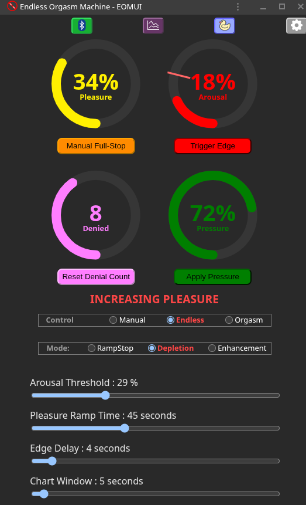
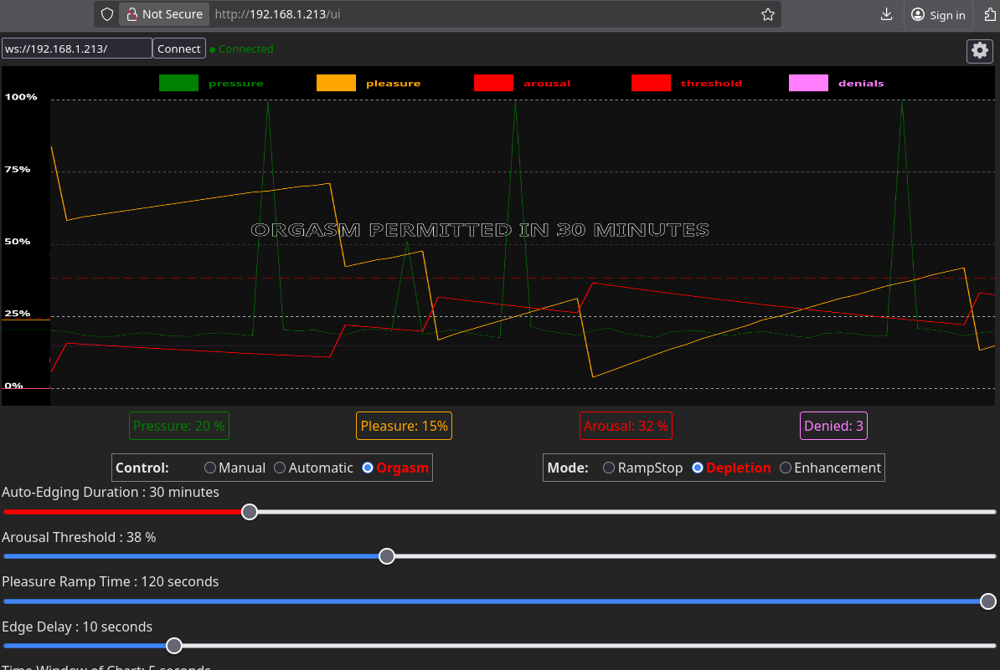

# Endless Orgasm Machine
**An automated orgasm denial and enhancement device for the DIY community**

### It knows...
What will surprise you most is how accurate it is that you only have a few moments left.  In this day and age algorithms are a respected part of our lives...this one knows you better than yourself.

Have you ever cut-off a sneeze before it happened and found it a conflicting blend of sensations?  Have you ever stopped before your orgasm so you could last a bit longer?  If you're not afraid to use a buttplug and you're ready for an amazing experience this is for you.  

It is not a sex-toy in the traditional sense because it doesn't provide pleasure unless you connect it to other toys.  It is an arousal sensor.  Other devices provide the pleasure, EOM tells them when to stop and when they can start again. (The exception being if you build in an integrated vibrator or e-stim plug)

### The science!
Using an inflatable butt plug to detect pressure changes indicative of pelvic floor contractions, this software, and associated hardware, is used to detect when the user is approaching orgasm and control stimulation accordingly. The net result: automated edging and orgasm denial or enhancement.

### But I like orgasms...

Having to wait for it while being right at the edge makes it more intense!  Trying to resist getting close is a turn-on for some.  When you're ready to end the edging you can use "Control: Orgasm" to allow you to finish after a chosen number of minutes or near-orgasms... if you've had enough simply set it to "Control: Manual" and take control of the toys manually.  It can also be used after orgasms to determine exactly when the refractory period has subsided enough to begin the next round of pleasuring. 

### Bonus feature:
You could use the app by itself to control multiple sex toys at once without am EOM being involved.  The app by itself is a versatile and simple control hub.


## Web UI

[The UI is posted at https://backroom-labs.github.io/eom/eomui/public](https://backroom-labs.github.io/eom/eomui/public) and can be installed on your Android or PC as a PWA app for offline use. 

This is what the app view looks like:
(the purple icon switches between chart mode and realtime mode)


The UI is not hosted on the device; the ESP32 only serves the WebSocket API (and Bluetooth). Use the hosted PWA above, or the Android/iOS app.

To connect over WiFi, click the WebSocket button and enter your EOM's address. If you join the EOM WiFi access point it is ```wss://192.168.4.1/```.  Because the hosted UI is served over https, browsers require a secure (```wss://```) connection: visit ```https://192.168.4.1/``` once and accept the self-signed certificate before connecting.  Bluetooth needs none of this.

### So how do I get one
Well, I'll get a store together eventually but for now you'll have to build it yourself.  These instructions are meant to make the simplest build possible so you can get playing. 

## Hardware
#### [Build examples here](doc/building/building.md)
STLs for the wrapped tubing version are in the [/hardware](/tree/main/hardware) directory.  

Also included are the source files for customizing your own plug.  They are designed in [OpenSCAD](https://openscad.org/), which may not be the easiest cad program to work with but its completely open-source and easily sharable for customization.

If you go with an inflatable plug you're on your own...There are not yet any files for enclosing the electronics and securing them...there are a million different products you could buy anyways so nothing could be made to fit.  If there is demand I'll post a simple box.

## Building the software
- Install [VSCode](https://code.visualstudio.com/) with the [pioarduino extension](https://github.com/pioarduino/platform-espressif32) (or add https://github.com/pioarduino/platform-espressif32 to the [PlatformIO](https://platformio.org/) extension)
- Open this repo and let all the PlatformIO dependencies download
- If you want to use websockets alongside or instead of bluetooth set "wifi_on" to true and configure your wifi ssid and password at the top of [data/config.json](data/config.json) or skip this step to let it broadcast its own access point: ```EOM```.  You can have it both ways: Set it up to connect to your home wifi but if you're away EOM will go into access point mode after it fails to find it.
- figure out the board you're using.  For a Xiao Seeed Esp32-S3 choose '''esp32-s3-devkitm-1'''.  For Waveshare Esp32-S3 choose ```waveshare_esp32_s3_zero```.  For a generic ESP32 like Wroom choose ```esp32dev```
- Under ```PlatformIO -> Project Tasks -> <your board> -> Platform``` choose ```Build Filesystem Image``` then ```Upload Filesystem Image```.  This uploads ```config.json``` plus a self-signed TLS certificate for ```wss://```, which is generated into ```data/``` on your first build (requires ```openssl```; see [tools/gen_cert.py](tools/gen_cert.py)).  The certificate and key are unique to your machine and are not committed to git.
- Under ```PlatformIO -> Project Tasks -> <your board> -> General``` choose ```Build``` then eventually ```Upload and Monitor```
- Watch for your device's IP address to be displayed in the monitor window 
(In access point mode it is 192.168.4.1)



## Updating the device

All updates are done over USB from PlatformIO (there is no over-the-air update yet).  The flash holds three separate things, and each is updated differently:

|What|Where it lives|Updated by|
|---|---|---|
|Firmware (all code in ```src/```, plus a built-in copy of ```data/config.json```)|app partition|```Upload``` (```pio run -e <board> -t upload```)|
|Filesystem: ```config.json```, ```server.crt```, ```server.key```|SPIFFS partition|```Upload Filesystem Image``` (```pio run -e <board> -t uploadfs```)|
|Settings saved from the UI|NVS + SPIFFS|The UI, or overwritten as described below|

**Firmware signing (groundwork for OTA updates).**  Every build signs ```firmware.bin``` with an ECDSA key that is generated into ```keys/``` on your first build (requires ```openssl```; see [tools/gen_signing_keys.py](tools/gen_signing_keys.py)).  The device will only accept over-the-air updates signed with the same key as the firmware it is running, so **back up ```keys/```**: it is not committed to git, and if you lose it, devices have to be updated over USB once more.  New firmware that crashes or stops running within 30 seconds of its first boot is rolled back automatically.

### Small code changes: firmware upload only
For day-to-day changes to anything in ```src/``` or a ```build_flags``` pin change in [platformio.ini](platformio.ini), you only need to reflash the firmware:

- ```PlatformIO -> Project Tasks -> <your board> -> General -> Upload and Monitor```
- or from a terminal: ```pio run -e <your board> -t upload -t monitor```

PlatformIO rebuilds only what changed, so this is quick.  The filesystem (TLS certificate) and the settings saved on the device are left alone.

**Changing settings in ```data/config.json```** also only needs a firmware upload.  The file is compiled into the firmware and on boot the device checks whether it has changed since it was last applied.  If it has, every key in the file overrides the value saved on the device; if it hasn't, settings you changed from the UI are kept.  An invalid JSON file is ignored (check the monitor for ```Built-in config.json is not valid JSON```).

The web UI is hosted separately (see [eomui/](eomui/)), so UI changes never need a device update.

### Full image: filesystem + firmware
Do a full update (```Build Filesystem Image``` -> ```Upload Filesystem Image```, then ```Upload and Monitor```) when:

- **Flashing a new board for the first time.**  Without the filesystem image there is no TLS certificate, so the device falls back to plain ```ws://``` and the hosted https UI can't connect over WiFi.
- **The certificate was regenerated**, e.g. you deleted ```data/server.crt```/```server.key``` or are building from a different computer.  You will need to accept the new certificate at ```https://<device-ip>/``` again.
- **A partition table changed** (```8mb_spiffs.csv```, ```min_spiffs.csv```, or ```board_build.partitions``` in [platformio.ini](platformio.ini)).  Run ```Platform -> Erase Flash``` first, because the old layout will not line up with the new one.
- **The device is misbehaving after an update** and you want a clean slate: ```Erase Flash```, then filesystem, then firmware.

From a terminal:
```
pio run -e <your board> -t erase      # only for a clean slate or partition changes
pio run -e <your board> -t uploadfs
pio run -e <your board> -t upload -t monitor
```

Be aware that ```Upload Filesystem Image``` replaces the ```config.json``` on the device, and ```Erase Flash``` wipes everything, so **any settings changed from the UI are lost**.  Put settings you want to keep into ```data/config.json``` first.

### Build-system changes: clean build
If you edit ```sdkconfig.defaults```, change the ESP-IDF/platform version, or switch boards and get odd build errors, delete the generated ```sdkconfig.<your board>``` file and run ```General -> Clean``` (```pio run -e <your board> -t clean```) before building.  ```sdkconfig.defaults``` is only read when that file doesn't exist yet, so it won't otherwise pick up your changes.  A clean build doesn't touch the device; upload the firmware as usual afterwards.

## bluetooth usage
WiFi is NOT necessary anymore!  The UI can work through bluetooth now! No ip address, wifi setup, or anything else needed.  Just connect to your EOM directly by clicking the bluetooth icon.  Android or PC Chrome only! Sorry Apple and Firefox enthusiasts but those two have deemed web bluetooth an unacceptable risk and it will never be available.

So how do you get that running? It is now configured as a PWA!  This means you can pull it up once from https://backroom-labs.github.io/eom/eomui/public and install it as an app.  It does not require an internet connection to work after installation...its just there in app mode ready to go.


### bluetooth usage with Xtoys:
Using Xtoys you can connect to the EOM and let it control your other Xtoys devices.  For Xtoys it emulates a device called [MonsterPub Mr. Devil Kegel](https://monsterpub.com/products/mp2-u-shaped-remote-egg-with-kegel).  Connect to the device called "EOM_BT" (or whatever you set ```bt_display_name``` to in [data/config.json](data/config.json)).  If Xtoys doesn't list it, set ```bt_display_name``` to ```"Libotoy"```, the name the real MonsterPub device uses, and upload the firmware again.  The "pressure" reading corresponds to the "pleasure" output of the EOM.  The sliders for vibrator strength will work in manual mode.

<small>Why Mr Devil?  Because it's one of the few bluetooth devices in Xtoys that has 2 way communication and high resolution (16 bit).  If you wish to connect Xtoys to the EOM over wifi you can choose the Edge-o-matic 3000 and it is backwards compatible.  This is less useful because Xtoys only chose to implement "arousal" and "pressure" inputs, so all the logic that goes into calculating the amount of pleasure is ignored.  </small>


### Pleasure Modes:

|ID|Name|Description|
|---|---|---|
|1|Ramp-Stop|Pleasure ramps up, stopping abruptly on arousal threshold crossing.  It's very frustrating.|
|2|Depletion (default)|Pleasure ramps up, but is reduced for even small arousal spikes.  This makes for a constant interaction with your arousal rather than just a sudden cutoff when it's over the limit|
|3|Enhancement|This is the opposite of edging, it will make you orgasm faster.  Pleasure ramps up as arousal increases, holding a peak for ramp_time.  Not compatible with Orgasm mode.|

## WebSocket API

Websockets are supported for backwards compatibility with nogasm and edge-o-matic devices, but not necessary for the current bluetooth implementation.  Documentation for the WebSocket API can be found in [doc/WebSocket.md](doc/WebSocket.md).

## Building tips

You can test this out on almost any ESP32 device without any extra hardware by touching the pin assigned to the pressure sensor.  Run your finger over all the pins if you're not sure which one it is.  This will be like a pressure sensor being squeezed.  To actually play with this device you will need to attach an actual pressure sensor and butt-plug (or 3d-printed tubing version).  The [MPX5100DP](https://www.digikey.com/en/products/detail/nxp-usa-inc/MPX5100DP/464060) is the sensor it was designed around but anything capable of 15psi or greater should work whether analog or SPI.  Plug the port of the pressure sensor into the air hose for the butt plug.  

To get it to resemble [the original Nogasm device](https://github.com/nogasm/nogasm) you can then add a [12v power supply](https://www.amazon.com/ACEIRMC-Battery-Plastic-Storage-Connect/dp/B0986RMKBJ) and [charger](https://www.amazon.com/Battery-Charger-Lithium-Display-RC123A/dp/B0CRKSFTK9), a [simple transistor](https://www.amazon.com/ALLECIN-IRF4905-Transistors-IRF4905PBF-Transistor/dp/B0CBKGJT9N) or more protected [motor controller](https://www.amazon.com/High-Power-Adjustment-Electronic-Controller-Brightness/dp/B0DZP1NCVW), a [flyback diode](https://www.amazon.com/15SQ045-Diodes-Schottky-Blocking-Silicon/dp/B0D4F2WVS5), and [vibrator motor](https://www.amazon.com/RPTCOTU-R555-Vibration-Motor-Electrodynamic/dp/B0CSYWK5KQ).  You could share that power supply to the esp32 [through a buck converter](https://www.amazon.com/Regulator-Reducer-Converter-Aircraft-MP1584EN/dp/B0B779ZYN1) to make the whole thing wireless.  That's it.  You can set this all up to attach to the buttplug rather than having a wires and tubes leading to a control box, but its a matter of opinion which way is better.  

Tested boards: ESP32DEV, ESP32-WROOM32, ESP32-C6 (WaveShare), ESP32-S3 (Seeed and Waveshare)


### Customization suggestions 
- You can use [Xtoys.app](https://xtoys.app) as a control panel to ramp up any number of vibrators, strokers, or e-stim units in sync with the EOM over bluetooth.  See [this Xtoys layout for an example](https://xtoys.app/layouts/-OcwSDDWBei-Bg4xwe5o)
- If you want to connect Xtoys via wifi you will need SSL enabled (```use_ssl``` in ```data/config.json```, on by default) and use the edge-o-matic Xtoys device.  The bluetooth connection is more useful since it sends pleasure level rather than arousal but there are some existing xtoys scripts that work with the edge-o-matic arousal level.
- You can use an inexpensive [Vibrating inflatable buttplug](https://www.amazon.com/Lovehoney-Black-Inflatable-Vibrating-Back/dp/B092VVXM63) and remove its control box to wire it directly to the EOM with a power circuit.  A [non-vibrating plug](https://www.amazon.com/Inflatable-Expandable-Stimulator-Beginners-Detachable/dp/B0DSPKVPM1) is even less expensive if you'll be controlling your pleasure wirelessly.
- If an [MPXV5100GP](https://octopart.com/search?q=MPXV5100GP&currency=USD) pressure sensor is too inconvenient or expensive to source you could use an easy to find [generic car exhaust pressure sensor](https://www.amazon.com/dp/B0997VKYQ9) since they are almost all analog 15psi 5v sensors.  The pin with the notch is Vin, middle is ground, third is Vout. Everything tested was 3V compatible.
- If you use an ESP32 board with an integrated screen ([Example 1](https://www.amazon.com/ideaspark-Development-Integrated-Wireless-Micropython), [Example 2](https://www.amazon.com/Waveshare-Development-Frequency-Single-Core-Processor/dp/B0DHTMYTCY)) you can enable the screen in [include/config.h](include/config.h) to see the IP of the device.
- As an alternative to a vibrating buttplug you can use [a plug made for enema play](https://www.amazon.com/Inflatable-Congestion-Cleaning-Expansion-Beginner/dp/B0CZRLPLQC) and pass a wire through the middle to an e-stim electrode or [to a vibrator on top](https://www.amazon.com/dp/B0024XI1LG).
- Someone posted a build that used tubing wrapped around a 3d printed shaft that also housed the electronics.  It was a neat new twist to the inflatable plug since the tubing reacted to pressure just like an inflatable.  The link is lost to time but it was on github somewhere.
- You could put in a higher range pressure sensor if you prefer to inflate the plug to more intense levels.  The measurement is of change in pressure, not overall pressure.
- You could order a [prebuilt PCB like is used for the Nogasm-esp32](https://github.com/Mathew3000/nogasm-esp32) 
- There really are a ridiculous number of implementations of the nogasm concept from the last decade...you should do some nogasm googling.


## Wait, isn't this the Edge-o-Matic 3000?  Or the Nogasm?

This is a fork of that project with a different set of goals.  The main goal is to make the project accessible to the maker community by keeping the hardware and software simple and DIY friendly - like [the original Nogasm](https://github.com/nogasm/nogasm) that started it all was.  The Edge-o-Matic code is designed around selling well-made but proprietary hardware and is [locked into it through closed-source code](https://github.com/MausTec/eom-hal-dist), crippling attempts to use it with DIY hardware.  It also included a lot of code to connect to related products and services.

This project was first vastly simplified then expanded with compatibility in mind.  You can try it using almost any modern ESP32 device with no additional customization.  You will need to connect a pressure sensor and inflatable buttplug to make it functional, but that's it.  It's meant to be operated wirelessly rather than through the additional hardware of a screen, knob, LEDs, network jack, etc.

Some notable differences are:
- Runs on nearly any ESP32 board!  DIY friendly
- Connects through bluetooth low energy
- Orgasm mode available over UI! (denies orgasms until timer runs out)
- Maximum denial count, so you get to finish after X number of edges
- UI hosted as PWA or on device... and is phone friendly
- defaults to endless orgasm denial in ramp-stop mode
- smaller build size, fits in your butt
- SD card requirement removed
- menu system removed
- console system removed
- action manager system removed
- hardwire networked device support removed 
- edge times are in seconds


## Standing on the shoulders of giants
This is a product of the open source community.  This will always be open source.  Sharing knowledge this way goes back to patent offices, or perhaps cave-man fire.  Sometimes the term can be abused by making things appear open when key information is obfuscated or by taking formerly open repositories offline...that practice of monetizing is also as old as time.  No shame.  Open-source doesn't mean no profiting and I'll try to make some money too. However this particular project intends to focus on information sharing and DIY accessibility as much as functionality.  You should be always be able to build this yourself if you have the free time.  That may not be the most profitable route but I hope the open-source community can elevate this project and make it even more useful than I am capable of.

## Contribution and Inspiration from:

- **Rhobot** with the original [nogasm project](https://github.com/nogasm/nogasm) that started it all
- **TheElims** Gave feedback and works on [a similar device with much more slick hardware](https://github.com/skier233/SmartAssPlug-development) - 
- **Skier23** who curates a [repository](https://github.com/Edging-Machines/Edging-Machines) and [discord](https://discord.gg/EvYbZBf) with all information regarding the topic.
- [Buttplug.io by Qdot](https://buttplug.io/) - Powers the connections from the EOM app to other bluetooth toys.  Him and his discord team are very helpful if irritable.
- **Rudolf**, who came up with the [coiled silicone tube](https://www.thingiverse.com/thing:3543727) as sensor element and even has written a [scientific paper](https://www.degruyter.com/document/doi/10.1515/pjbr-2020-0014/pdf) on that topic.
- **Maus-Tec** who manufactures and sells the [Edge-O-Matic](https://github.com/MausTec/edge-o-matic-3000)
- **Onwrikbaar** with his bullfrog, who refined the simple [nogasm algorithm](https://github.com/Onwrikbaar/Bullfrog) with a peak summation and decay function.
- **night-howler** who contributed a breadboard friendly version of the nogasm called [protogasm](https://github.com/night-howler/protogasm).

### To-do priority
- connect to DG Labs Coyote
- support for more bluetooth LED types
- add build walkthrough to docs and more examples, pinouts and schematics
- audio buzzer in ui for cooldown!
- add a config save button so setting changes aren't immediately permanent (save toy settings also/separately?)
- do canvas drawing to offscreen element for efficiency
- integrate smoothing filters into pressure readings
<!-- - ui and websockets using same endpoint if possible -->
- bug: arousal overflows on hardware side
- logging from the app
- battery monitoring characteristic
- add X axis on chart (seconds)
- chart glitch on left side at startup
- make motor pin selection more intuitive (add motor hardware in general)
- display individual toy battery levels
- bluetooth OTA?
- device disconnection (buttplug bug)
- disable internal motor control option?
- integrated screen support / ip display
- Implement patterns?  That's a biggie
- Running average math seems off
